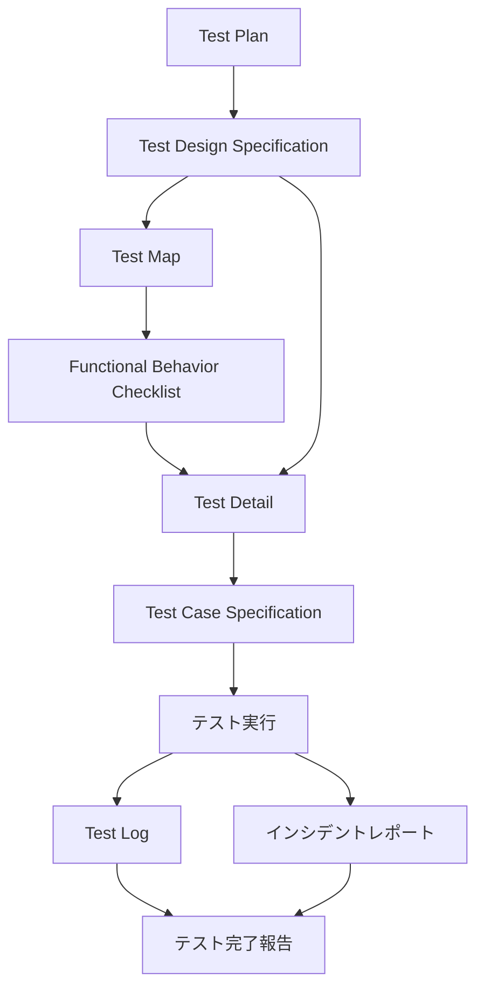

# テスト文書作成ガイドライン

## 1 はじめに

### 1.1 目的

本書は、テストの計画から実行結果までを対応付けた文書による、テストの抜け漏れの防止及び判定の一貫性の確保を目的とする。

### 1.2 適用範囲

本書は、テストの計画、設計、実行記録及び終結の各段階で作成する文書の作成方法について規定する。

注記 テスト対象、テストケースの選定方法及び検証内容の方針は、[テストガイドライン](../software/testing-guidelines.md)による。本書は、その方針で選んだテストを文書に記載する方法を扱う。

### 1.3 用語及び定義

本書で用いる主な用語及び定義は、[表1](#table-1)による。

表1−用語及び定義

| 用語 | 定義 |
| --- | --- |
| テストベース | テストの分析及び設計の根拠となる要求、仕様などの情報。 |
| テスト観点 | テストで確認する性質又は振る舞いを分類する項目。 |
| テストセット | 同じ機能及び観点に対応するテストケースのまとまり。 |
| テストモデル | 仕様を基に、テスト条件を数直線、表、図などで整理したもの。 |
| テストカバレッジアイテム | テストモデルから識別した、テストで網羅する対象。境界値、デシジョンテーブルのルール、状態遷移などがある。 |
| 因子 | テスト結果に影響する設定項目、入力項目又は条件。 |
| 水準 | 因子が取る値又は選択肢。 |
| プロダクトリスク | 製品が必要な品質を満たさない可能性及びその影響。 |
| プロジェクトリスク | 日程、費用、体制などが作業の遂行に与える不確実性。 |
| インシデント | テストの実行中に発生した、期待結果と異なる事象又は調査が必要な事象。 |
| テストチャーター | 探索的テストで、テストの対象、観点及び目的を示す文書。 |
| セッション | 探索的テストで、一つのテストチャーターに従ってテストを実行する時間枠。 |

## 2 文書の構成

### 2.1 作成順序

テスト文書は、計画、設計、具体化、実行記録及び終結の順に作成する。前の文書で定義した対象及び識別子を引き継ぎ、確認する要求及び実行結果を追跡可能にする。

文書の作成順序を[図1](#figure-1)に示す。

図1−テスト文書の作成順序

Test Map、Functional Behavior Checklist及びTest Detailは、Test Design Specificationのテスト設計の流れで作成する資料である。

探索的テストでは、Test Detail及びTest Case Specificationの代わりにテストチャーターを作成する（[14章](#14-探索的テストの記録)参照）。

### 2.2 作成する文書の選択

作成する文書は、テストの結果を文書として提出又は承認する必要があるか、及びテストを自動化しているかによって選ぶ。全ての文書を作成すると、小規模な開発では文書の保守がテストの実施を上回る負担になり、文書とテスト対象とがずれていく。

省略した文書の役割は、別の手段で果たす。省略した文書と代わりの手段とは、Test Plan又はテスト方針に記載する。文書を省略しても、テスト観点の洗い出し及びテスト技法による条件の整理は省略しない。

状況ごとに作成する文書の目安を[表2](#table-2)に示す。

表2−状況ごとに作成する文書の目安

| 状況 | 作成する文書 | 文書の代わりに使う手段 |
| --- | --- | --- |
| 受託開発、第三者検証など、テストの結果を文書として提出又は承認する | 本書で規定する全ての文書 | − |
| 組織内で継続して開発し、テストの多くを自動化している | Test Plan テスト観点一覧 Test Map インシデントレポート テスト完了報告 | Test Case Specificationの代わりにテストコード Test Logの代わりに継続的インテグレーションの実行記録 |
| OSSとして公開して開発する | テスト方針 手動テストのチェックリスト | Test Case Specificationの代わりにテストコード Test Logの代わりに継続的インテグレーションの実行記録 インシデントレポートの代わりにIssue |

テスト方針には、テストの種別ごとの担当範囲、テストの対象にするもの及びしないもの、並びにテストの実行方法を記載する。OSSでは、テスト方針をCONTRIBUTING.mdなど、コントリビューターが最初に読む文書に記載する。

手動テストのチェックリストには、画面、実機、インストーラーなど、自動化していないテストだけをリリース前に確認する項目として記載する。

テストコードをテストケースの代わりにする場合は、テストコードがTest Case Specificationの役割を果たすように書く。

- テスト名には、そのテストで確認する振る舞いを記載する。テスト名を読めば、テスト観点及び期待結果が分かるようにする。
- 境界値、デシジョンテーブルのルールなど、テストモデルから導いた条件は、パラメーター化テストの1行に1件の条件が対応するように記載する。
- 要求事項の識別子がある場合は、テスト名又はテストコードの注記に記載する。

テストコードの書き方は、[テストガイドライン](../software/testing-guidelines.md)による。

## 3 文書の識別及び管理

各文書及び記録には、識別情報、対象範囲及び参照先を記載する。文書間で対象の版及び識別子を一致させ、計画と結果との対応を確認可能にする。

要求事項からテストケースまでを追跡可能にするため、Test Detail及びTest Case Specificationには、確認する要求事項の識別子を記載する。要求事項の識別子は、[ソフトウェア要求仕様書](../../templates/documentation/software-requirements-specification.md)などのテストベースで付けた識別子を使う。一つのテストケースが複数の要求事項を確認する場合は、全ての識別子を記載する。テストの完了時に、全ての要求事項の識別子が一つ以上のテストケースに記載されていることを確認する。

文書の識別及び管理は、[表3](#table-3)による。

表3−文書の識別及び管理

| 要素 | 内容 |
| --- | --- |
| 一意の識別子 | タイトル、発行日、バージョン、文書のステータスなど、文書又は記録を一意に識別する情報。 |
| 発行組織 | テスト文書の作成及び発行に責任をもつ組織。 |
| 承認権限 | テスト文書及び記録の責任者。 |
| 変更履歴 | テスト文書及び記録の開始以降に行われた変更のログ。 |
| ステータス | 作成中、承認済みなど、テスト文書の現在状態。 |
| はじめに | テスト文書及び記録の背景及び位置付け。 |
| スコープ | テスト文書及び記録が対象とする範囲。除外事項及び制限事項がある場合は記載する。 |
| リファレンス | 参照した他の文書又は記録及びその保管場所。 |
| 用語集 | テスト文書で使用する用語、略語及び頭字語の説明。 |

## 4 Test Plan

### 4.1 役割

Test Planは、テストの設計、実装、実施及び管理に関する指針を定め、テストの目的、背景、スコープ、スケジュール、役割、体制、リスクなどを整理する。

記載内容は、実際のテスト対象及びプロジェクトに合わせる。例えば、実施しないテストレベルは、対象範囲と区別して記載する。

Test Planは、テストチームだけでなく開発者とも共有し、テストの優先順位及び完了の条件について合意を得る。

### 4.2 計画書に記載する項目

Test Planには、[表4](#table-4)の項目を記載する。各項目の記載先は、リポジトリ内のテンプレートに対応する。

表4−計画書に記載する項目

| 箇所 | 必須項目 |
| --- | --- |
| 文書情報 | 文書番号、版、ステータス及び発行組織 |
| 変更履歴 | 版、日付及び変更内容 |
| 1.1 | 目的 |
| 1.3 | 用語及び定義 |
| 2.1 | 本書の対象 |
| 2.2 | テストベース |
| 3.1 | テストの背景 |
| 3.2 | テストの目的及び目標 |
| 4.1 | 対象テストレベル |
| 4.4 | テストアイテム |
| 4.5 | テストタイプ |
| 6.2 | テスト対象範囲 |
| 7章 | プロダクトリスク |
| 8.5 | テストに用いる技法 |
| 9.1 | テスト期間 |
| 9.2 | スケジュール |
| 9.3 | 成果物 |
| 9.4 | 見積 |
| 10.1 | テスト開始／終了基準 |
| 10.2 | テスト中断／再開基準 |
| 10.3 | テスト完了基準 |
| 10.4 | 再テスト／リグレッションテスト実施条件 |
| 10.5 | テスト実施結果の判定基準 |
| 11章 | 収集するメトリクス |
| 12.1 | テスト環境要件 |
| 12.2 | テストデータ要件 |
| 13.3 | テスト体制 |
| 13.5 | ステークホルダー |
| 13.8 | テスト実施者の独立性 |
| 14.2 | プロジェクトリスク |
| 参考文献 | 参照した資料及び使用した章 |

### 4.3 本書の対象

テストのスコープを明確にするため、テスト対象、対象ユーザー、システムの目的、システムの利用方法に関する詳細及び開発分類を記載する。

スコープに含まれる補足事項、除外、制限又は仮定がある場合も記載する。

### 4.4 テストの背景、目的及び目標

対象のプロジェクト、テストレベル、テストタイプなどの前後関係及び状況を記載する。

テンプレートでは背景を“現在の状況”と“問題点／懸念事項”に分けているが、この区分だけに限定する必要はない。

目的には、テストを行う理由を記載する。目標には、目的を達成したと判断するための到達点を記載する。テストの対象範囲、テスト終了基準及び成果物を合わせて記載し、何がどの状態になればテストを終えられるかを読者が判断できるようにする。

例 目的“認証方式の変更後も、既存の利用者が要求どおりにログインできることを確認する。”に対し、目標を“対象範囲のテストケースを全て実施し、重大度Aのインシデントが未解決で残っていない状態にする。”とする。

### 4.5 テストレベル

単体テスト、結合テスト、システムテスト、受入テストなど、この計画で対象とするテストの段階を明確にする。

### 4.6 テストアイテム

このテストでカバーする対象要素を識別する。

対象となるファームウェア又はソフトウェアのバージョン及びリビジョンの情報がある場合は、明確にする。

### 4.7 テストタイプ

機能テスト、性能テスト、ストレステストなど、この計画で扱うテストタイプを明確にする。

仕様どおりに実装されているかを確認する検証（Verification）と、利用者の要求を満たしているかを確認する妥当性確認（Validation）の両方を対象にする場合は、それぞれをどのテストタイプで確認するかを記載する。応答時間、操作の分かりやすさなど、仕様書に明記されにくい利用者の要求は、妥当性確認のテストタイプとして計画する。

### 4.8 リスク

テスト計画活動で特定したリスクを列挙し、影響及び確率に基づいて評価及び分析する。

リスクの種類、分類及びリスクスコアに基づいて、リスクを処理するための手段を特定する。

プロダクトリスクとプロジェクトリスクとを分けて管理する。

プロダクトリスクを洗い出す際は、欠陥が集中しやすい箇所を確認する。欠陥が集中しやすい箇所には、次のものがある。

- 機能と機能との境目及びシステム間の連携
- 状態が遷移する箇所
- 入力値の範囲及び条件の境目
- 今回変更した箇所及びその影響を受ける箇所
- 過去に不具合が多く発生した機能

プロダクトリスクの評価結果は、機能及び観点の重要度、テスト技法の選択及びテスト量に反映する。

### 4.9 テストに用いる技法

テスト計画のスコープに対して、使用するテスト設計技法を指定する。

技法は、テスト対象の仕様の特徴に合わせて選ぶ。技法の選択の目安を[表5](#table-5)に示す。

表5−テスト技法の選択の目安

| テスト対象の仕様の特徴 | 使用する技法 | 整理に用いる形式 |
| --- | --- | --- |
| 入力値又は条件に範囲がある | 同値分割法 境界値分析 | 数直線 同値パーティションの表 |
| 複数の条件の組合せで結果が決まる | デシジョンテーブルテスト | デシジョンテーブル |
| 状態とイベントによって動作が変わる | 状態遷移テスト | 状態遷移図 状態遷移表 |
| 多数の設定項目を組み合わせて使う | 組合せテスト（直交表、ペアワイズ法） | 因子水準表 組合せ表 |
| 複数の機能又はシステムを連携させて業務を行う | シナリオテスト | 業務フロー |
| 仕様書が不足している、又はテストの準備期間が短い | 探索的テスト | テストチャーター |

技法を使うこと自体を目的にしない。技法は、必要なテスト条件を漏れなく抽出し、テストケースの数をリスクに見合った量にするために使う。

技法ごとの記載方法は、[9章](#9-テスト条件の整理)、[10章](#10-シナリオテストの設計)及び[14章](#14-探索的テストの記録)による。

### 4.10 テスト開始／終了基準

テストの開始基準及び終了基準を明確にする。

プロセス、テストレベル又はテストタイプによって異なる基準を定める場合は、それぞれ記載する。

### 4.11 テスト中断／再開基準

対象のテスト活動を中断及び再開するための基準を指定する。

中断及び再開を判断する権限をもつ者も特定する。

### 4.12 テスト完了基準

テストの完了基準を明確にする。

使用するテスト技法に完了の判定基準がある場合は、その基準を記載する。

例 境界値分析では全ての境界値を、デシジョンテーブルテストでは全てのルールを、状態遷移テストでは全ての有効な遷移及び状態遷移表の全てのセルを、組合せテストでは全ての2因子間の組合せを実行したことを完了基準とする。

### 4.13 収集するメトリクス

対象のテストで収集し、モニタリングするメトリクスを明確にする。

開発規模など、開発側からの情報提供が必要なデータがある場合は、事前に情報提供が可能か確認する。

## 5 Test Design Specification

### 5.1 役割

Test Design Specificationは、Test Planを基に、対象機能、テスト観点及び設計の進め方を定義する。設計者間で確認する範囲をそろえ、具体的なテストケースへ展開するために使用する。

対象が大きい場合又はテストタイプごとに責任者が異なる場合は、分冊して作成してもよい。

### 5.2 主な内容

主な内容は次のとおりである。

- テストの目的及び背景並びに重要テスト項目
- テスト設計のプロセス定義
- テストアプローチ
- テスト環境・使用機材

プロジェクトのテスト対象に応じて、項目を補ってもよい。

### 5.3 テストの目的及び背景並びに重要テスト項目

Test Planで整理した内容を、Test Design Specificationの記載範囲に合わせて再確認する。

プロジェクトの状況及びテストへの要求を把握し、その内容を基にテストの指針を定める。

テストの目的、背景及び理由を、過去の不具合及びテスト履歴と合わせて確認する。目的に関係しないテストを設計しないようにするためである。

### 5.4 テスト設計のプロセス定義

テスト設計工程の手順を記載する。

組織で定義した標準的なプロセスをプロジェクト向けに変更した場合、又は独自の工程を追加した場合は、実際に使用する流れを文書化して共有する。

### 5.5 テストアプローチ

#### 5.5.1 テストアプローチの要点

“どの部分をテストするのか”“どのような内容のテストをするのか”を定義するため、テスト対象機能一覧及びテスト観点一覧を作成する。

#### 5.5.2 テスト対象機能一覧

テストの設計及び実施が容易な単位に対象を分割する。

開発資料に分類又は用語が定義されている場合は、それを基にする。機能一覧がない場合は、要件一覧又は画面一覧で代用するか、テスト対象を操作しながら作成する。作成した一覧は、ステークホルダーに確認してもらい、抜けがないかを確かめる。

細分化しすぎてテストの全体像が分かりにくくならない粒度にする。

#### 5.5.3 テスト観点一覧

テスト観点は、“どのような内容のテストを実施するのか”という確認内容の分類を表す。

テスト観点一覧には、観点を大分類、中分類及び小分類に分けて記載し、小分類ごとに確認内容を記載する。観点の洗い出し方は、[5.6](#56-テスト観点の洗い出し)による。

細分化しすぎず、何を確認すればよいか想像できる抽象度にする。“正常系”“入力チェック”のような名称だけでは確認内容が伝わらないため、確認内容の列に何を確認するかを文で記載する。

### 5.6 テスト観点の洗い出し

#### 5.6.1 観点の情報源

テスト観点は、次の情報源から洗い出す。

- 要求、仕様書及び設計書などのテストベース
- 組織又は製品ごとに蓄積した観点一覧
- 過去のプロジェクトのテスト資料及び不具合の記録
- 利用者の使い方及び運用の条件
- [4.8](#48-リスク)で洗い出したプロダクトリスク

既存の観点一覧だけに頼らず、テスト対象を分析して、対象に固有の観点を加える。

#### 5.6.2 観点の分類

観点の大分類には、品質特性、テストタイプ又は確認する振る舞いの種類を使う。同じ一覧の中では、大分類の基準を混在させない。

確認する振る舞いの種類で分類した観点の例を[表6](#table-6)に示す。

表6−観点の例

| 大分類 | 確認内容 |
| --- | --- |
| 機能動作 | 機能が仕様どおりの結果を返すこと。 |
| 画面表示 | 文言、レイアウト、文字切れ及び表示崩れがないこと。 |
| 入力 | 入力値の範囲、文字種、文字数及び必須項目が仕様どおりに扱われること。 |
| 画面遷移 | 操作及びイベントに対して、仕様どおりの画面へ遷移すること。 |
| エラー処理 | 仕様で定義したエラーが、定義どおりの表示及び動作になること。 |
| 異常操作 | 連続操作、操作の中断及び想定外の順序の操作で、異常な状態にならないこと。 |
| 設定保持 | 変更した設定値が、再表示、再起動などの後も保持されること。 |
| 排他処理 | 複数の利用者又は端末が同じデータを同時に扱う場合に、仕様どおりに排他されること。 |
| 環境依存 | 対象とするOS、ブラウザ、端末などの環境の違いによって、動作が変わらないこと。 |
| 業務シナリオ | 複数の機能を連携させた一連の業務が、最後まで完了すること。 |

#### 5.6.3 観点の見直し

作成した観点一覧は、開発者及びテスト設計者でレビューする。開発者が確認しやすいよう、仕様書の章及び機能一覧との対応が分かる一覧表にする。

テストの実施中に新しい観点が見つかった場合は、観点一覧に追加し、Test Mapの対応を更新する。テスト終結時には、観点一覧を次のプロジェクトで使用する資産として更新する（[15章](#15-テスト終結)参照）。

### 5.7 重要度

機能及び観点に重要度を設定し、どの程度重点的にテストするかを定める。

Test Planで決定した重要度の方針を引き継ぐ。

設計を進めた結果、重要度の見直しが必要と分かった場合は、必要に応じてTest Planまで戻って検討する。

### 5.8 テスト環境・使用機材

テストに必要な環境及び使用機材を整理する。

機材の調達、テスト環境のセットアップ、事前の動作確認、必要なトレーニングなど、テスト実施前に準備するタスクも洗い出す。

### 5.9 作成時の注意点

後続のTest Map、Functional Behavior Checklistなどの基になるため、具体的にどのようなテストをするのかを想像しながら作成する。

他の人が参照することを前提に、分かりやすい記述及び分類にする。

### 5.10 活用

Test Design Specificationは、次の用途で利用する。

- ステークホルダーと、テストがシステムへの要求及びテストへの要求に合致しているかを確認する。
- 複数人でテスト設計を行う場合の方針をそろえる。
- テストケースと開発仕様書とのトレーサビリティを取る資料として利用する。
- テスト実施者がテスト全体の方向性及びテストケースの作成意図を理解するために利用する。
- 保守又は派生開発で、既存のテストケースを流用する範囲を判断するために利用する。

## 6 Test Map

### 6.1 役割

Test Mapでは、テスト対象機能とテスト観点とをマトリクス化し、テスト実施可否及び重要度を決定する。

### 6.2 記載内容

テスト対象機能として、No、大項目、中項目、小項目及び重要度を記載する。

テスト観点として、No、大分類、中分類及び小分類を記載する。

機能と観点との交点には、[表7](#table-7)の記号のうち、計画書で採用したものを使用する。

表7−交点の記号

| 記号 | 意味 |
| --- | --- |
| A | 重点的に実施 |
| B | 普通 |
| C | 最低限実施 |
| － | 実施不可 |
| NT | 実施なし |
| ○ | 実施 |
| △ | 実施検討 |

特記事項がある場合は、特記事項欄へ記載する。

### 6.3 交点の判断

全ての交点を機械的に実施対象にせず、機能と観点との組合せに意味があるかを判断する。

“実施不可”又は“実施なし”とした交点は、特記事項欄にその理由を記載する。後から対象外とした理由を確認可能にするためである。

## 7 Functional Behavior Checklist

### 7.1 役割

Functional Behavior Checklistは、観点“機能動作”に対して、機能ごとの確認内容を明確にするために使用する。

### 7.2 記載内容

記載内容は、[表8](#table-8)による。

表8−Functional Behavior Checklistの記載内容

| 項目 | 内容 |
| --- | --- |
| No. | 項目番号 |
| 大項目 | 該当テスト項目で確認する機能の大分類 |
| 中項目 | 該当テスト項目で確認する機能の中分類 |
| 小項目 | 該当テスト項目で確認する機能の小分類 |
| 機能要件（要求／リスクベース） | 機能に対して必要な要件 |
| 確認内容 | 機能要件の確認に必要な内容 |
| 備考 | 補足事項 |

確認内容は、実装の内部処理ではなく、外部から確認可能な振る舞いで記載する。

特記事項がある場合は、特記事項欄へ記載する。

## 8 Test Detail

### 8.1 役割

Test Detailでは、テスト対象となる機能と観点との組合せに対して、実施するテスト内容の明細を記載する。

### 8.2 グループ項目

グループ項目は、[表9](#table-9)による。

表9−Test Detailのグループ項目

| 項目 | 内容 |
| --- | --- |
| テスト対象1 | テストを実施する対象システム |
| テスト対象2 | テストを実施する対象システム内要素 |
| テストタイプ | 該当テストの分類 |
| 大項目 | 該当テスト項目で確認する機能の大分類 |

### 8.3 個別項目

個別項目は、[表10](#table-10)による。

表10−Test Detailの個別項目

| 項目 | 内容 |
| --- | --- |
| テストセットID | 該当テストセットの識別番号 |
| 要求事項の識別子 | テストセットで確認する要求事項の識別子 |
| 中項目 | 該当テスト項目で確認する機能の中分類 |
| 小項目 | 該当テスト項目で確認する機能の小分類 |
| セット内容 | テストセットの内容説明 |
| テスト観点 | Test Mapにおけるテスト対象機能に対応したテスト観点 |
| 確認内容 | テスト観点ごとの詳細な確認内容。観点一覧から抽出し、詳細化する。 |
| テストパラメーター | 確認内容の入力条件パターン |
| 件数 | 該当のテスト実施時に必要となるテスト件数 |

テンプレートでは、テストパラメーターを因子／水準として記載する。

テストパラメーター及び件数は、[9章](#9-テスト条件の整理)の方法でテスト条件を整理して導く。整理に使った数直線、デシジョンテーブル、状態遷移表などは、Test Detailに添付するか、参照先を記載する。

## 9 テスト条件の整理

### 9.1 整理の流れ

テストパラメーターは、次の順序で導く。

a) 仕様を基に、テストモデルを作成する。テストモデルには、数直線、デシジョンテーブル、状態遷移表、因子水準表などを使う。

b) テストモデルから、テストカバレッジアイテムを識別する。

c) テストカバレッジアイテムを網羅するように、テストケースの入力値及び期待結果を決める。

テストモデルを作成する過程で、仕様の曖昧な箇所、矛盾する箇所又は定義がない箇所が見つかった場合は、テストモデルの該当箇所に“？”を記載し、開発者に確認する。確認結果は、仕様書への反映を依頼する。

### 9.2 同値分割法及び境界値分析

#### 9.2.1 同値パーティションの記載

入力値を、同じ結果になる値の集合（同値パーティション）に分け、有効な同値パーティションと無効な同値パーティションとを区別して記載する。

同値パーティションは、範囲が連続する場合だけでなく、特定の文字種、特定の値など、連続しない集合になる場合もある。

各同値パーティションから代表値を選ぶ。代表値でテストしても、パーティション内の全ての値をテストしたことにはならないため、重要な値は代表値とは別に追加する。

#### 9.2.2 境界値の記載

境界には、数直線を添えて記載する。数直線には、端点を含むかどうか、及び値の最小の単位（整数、小数点以下の桁数、秒など）を明記する。

“以上”“以下”“未満”“を超え”の使い方は、[技術文書作成ガイドライン](technical-document-guidelines.md#432-以上以下を超え及び未満)の4.3.2による。仕様書の表現から端点を含むかどうかを判断できない場合は、開発者に確認する。

境界値は、有効な範囲の端の値と、それに隣接する無効な範囲の値との組で選ぶ。

例 注文数量が1以上99以下の整数である場合、境界値を[表11](#table-11)のように記載する。

表11−境界値の記載例

| 入力値 | 同値パーティション | 期待結果 |
| --- | --- | --- |
| 0 | 無効（1未満） | 数量の入力エラーを表示する。 |
| 1 | 有効 | 注文を受け付ける。 |
| 99 | 有効 | 注文を受け付ける。 |
| 100 | 無効（99を超える） | 数量の入力エラーを表示する。 |

#### 9.2.3 複数の条件の境界

複数の条件に境界がある場合は、条件ごとに数直線を作成した後、一方の条件を行、他方の条件を列とした表にまとめる。行と列の交点には期待結果を記載し、交点ごとにテストケースを導く。

### 9.3 デシジョンテーブル

#### 9.3.1 デシジョンテーブルの構成

デシジョンテーブルは、上側の条件部と下側の動作部とで構成する。条件部及び動作部の各行には、条件又は動作の内容を記載し、各列（ルール）には、条件の組合せ及びそのときの動作を記号で記載する。

デシジョンテーブルで用いる記号は、[表12](#table-12)による。

表12−デシジョンテーブルの記号

| 記号 | 記載する部分 | 意味 |
| --- | --- | --- |
| Y | 条件部 | 条件を満たす。 |
| N | 条件部 | 条件を満たさない。 |
| DC | 条件部 | 条件が動作に影響しない。 |
| X | 動作部 | 動作を実行する。 |
| − | 動作部 | 動作を実行しない。 |

条件及び動作は、短く曖昧さのない文で記載する。動作部に複数の動作を記載する場合は、動作が実行される順に並べる。

例 図書の貸出の仕様を、[表13](#table-13)のように記載する。

表13−デシジョンテーブルの記載例

| 区分 | 条件又は動作 | ルール1 | ルール2 | ルール3 | ルール4 |
| --- | --- | --- | --- | --- | --- |
| 条件 | 利用者登録がある | Y | Y | Y | N |
| 条件 | 延滞中の資料がない | Y | Y | N | DC |
| 条件 | 貸出冊数が上限未満である | Y | N | DC | DC |
| 動作 | 貸出を受け付ける | X | − | − | − |
| 動作 | 貸出できない理由を表示する | − | X | X | X |

1ルールを1テストケースとする。テストケースへ展開する際は、ルールの列を行に置き換え、条件を実施条件に、動作を期待結果に記載する。

#### 9.3.2 表の大きさの調整

条件が一つしかない場合、又は条件同士が関連しない場合は、デシジョンテーブルを使わない。

デシジョンテーブルがテストできないほど大きくなる場合は、次の方法で小さくする。

- 一部の条件だけで動作が決まるルールは、他の条件をDCとして一つのルールにまとめる。ただし、全ての条件の組合せを確認する必要がある場合は、まとめない。
- 関連の低い条件の組を、別のデシジョンテーブルに分ける。
- 条件部又は動作部のセルに、Y及びN以外の値（“100円”“以上”など）を記載し、行の数を減らす。

#### 9.3.3 作成後の確認

デシジョンテーブルを作成した後、次の事項を確認する。

- 同じ条件の組合せのルールが、複数存在しない。
- 実際には起こりえない、矛盾した条件の組合せがない。
- 各ルールの前提となる状態がそろっており、あるルールの動作結果が別のルールに影響しない。

### 9.4 状態遷移

#### 9.4.1 状態遷移図及び状態遷移表

状態によって動作が変わる対象は、状態遷移図と状態遷移表との両方で整理する。状態遷移図は、起こりうる遷移を全体として把握するために使い、状態遷移表は、全ての状態とイベントとの組合せの抜けを確認するために使う。

状態遷移表は、[表14](#table-14)のいずれかの形式で作成する。

表14−状態遷移表の形式

| 形式 | 行 | 列 | セルに記載する内容 | 用途 |
| --- | --- | --- | --- | --- |
| 状態×イベント | 遷移前の状態 | イベント | 遷移後の状態 | 各状態で発生するイベントを網羅的に洗い出す。 |
| 状態×状態 | 遷移前の状態 | 遷移後の状態 | 遷移のきっかけとなるイベント | 状態の組合せとイベントとの関係を洗い出す。 |

状態遷移表のセルで用いる記号は、[表15](#table-15)による。

表15−状態遷移表の記号

| 記号 | 意味 |
| --- | --- |
| − | イベントが発生しても遷移しない。 |
| N/A | その状態では、イベントが発生しえない。 |
| ？ | 仕様で定義されておらず、確認が必要である。 |

例 会議室の予約の状態遷移を、[表16](#table-16)のように記載する。

表16−状態遷移表の記載例

| 遷移前の状態 | 確定操作 | 取消操作 | 利用開始時刻の到来 |
| --- | --- | --- | --- |
| 仮予約 | 確定 | 取消済み | 取消済み |
| 確定 | − | 取消済み | 利用中 |
| 取消済み | − | − | N/A |
| 利用中 | − | ？ | N/A |

#### 9.4.2 テストケースへの展開

状態遷移図の全ての遷移と、状態遷移表の全てのセルとをテストカバレッジアイテムとする。“−”のセルでは、イベントを発生させても遷移しないことを確認する。“N/A”のセルは、テストケースにしない。

状態遷移テストで検出する不具合には、異なる状態へ遷移する、遷移すべきときに遷移しない、及び遷移すべきでないときに遷移する、の3種類がある。遷移することだけでなく、遷移しないことも期待結果に記載する。

イベントには、利用者の操作だけでなく、時間の経過、センサーの検知、他のシステムからの通知なども含める。テストの目的に応じて、画面から発生させられないイベント及び外から見えない内部の状態も状態遷移表に含める。

業務の一連の流れを確認する場合は、状態遷移図の経路をたどる手順を1テストケースとして記載してもよい。

### 9.5 組合せテスト

#### 9.5.1 因子水準表

組合せテストでは、テスト対象の因子及び水準を因子水準表にまとめる。因子水準表は、開発者及びテスト設計者でレビューし、テストに関係する因子及び水準の抜けがないことを確認する。テストに関係しない因子を組み合わせても、不具合の検出にはつながらない。

因子には、設定項目のほか、割込みのタイミング、遷移前の状態、経過時間なども含める。数値の範囲をもつ因子の水準は、同値分割法及び境界値分析で選ぶ。

#### 9.5.2 組合せ方

全ての因子の全ての水準を組み合わせるとケース数が多くなりすぎる場合は、任意の2因子の水準の組合せを全て含める2因子間網羅で組合せ表を作成する。

例 印刷の因子“カラー”“面”“用紙”の各2水準を2因子間網羅で組み合わせると、[表17](#table-17)の4件になる。全ての組合せの8件に比べて件数が減るが、“カラー、片面、A3”のような3因子の組合せの一部は含まれない。

表17−2因子間網羅の組合せ表の例

| No | カラー | 面 | 用紙 |
| --- | --- | --- | --- |
| 1 | カラー | 片面 | A4 |
| 2 | カラー | 両面 | A3 |
| 3 | モノクロ | 片面 | A3 |
| 4 | モノクロ | 両面 | A4 |

組合せ表の作成方法は、[表18](#table-18)から選ぶ。

表18−組合せ表の作成方法

| 作成方法 | 特徴 | 向いている対象 |
| --- | --- | --- |
| 直交表 | 因子数及び水準数によって使える表が決まる。3因子以上の組合せも比較的多く含む。 | 因子の水準数がそろっている対象。3因子間の組合せも確認したい対象。 |
| ペアワイズ法 | 因子数及び水準数の制約がなく、ツールで生成する。ケース数は直交表より少ない傾向にある。 | 因子が多く、水準数がばらばらな対象。短期間で広く確認したい対象。 |

#### 9.5.3 組合せ表の調整

生成した組合せ表は、次の調整をしてからテストケースにする。

- 実際には成立しない組合せ（禁則）を除き、除いたことで欠けた2因子間の組合せを別のケースで補う。
- 全ての設定を無効にした状態など、テストとして必要な組合せが含まれていない場合は追加する。
- 環境の切替え回数が少なくなるよう、ケースの順序を並べ替える。並べ替えは行単位で行い、一部の因子の列だけを並べ替えない。列だけを並べ替えると、2因子間網羅が崩れる。

組合せテストを適用する範囲は、リスクとコストとを比べて決める。例えば、新しい機能は全ての組合せに近い数を確認し、変更のない既存機能には2因子間網羅を適用する。

## 10 シナリオテストの設計

### 10.1 役割

シナリオテストは、利用者の業務又は複数の機能及びシステムの連携を一連の流れとして実行し、業務の遂行を妨げる不具合を検出するテストである。機能ごとのテストでは、機能を連携させたとき、及び実際の業務の順序で操作したときに表面化する不具合を検出できないため、シナリオテストを別に設計する。

### 10.2 設計の流れ

シナリオテストは、次の順序で設計する。

a) 業務フローを作成し、シナリオテストに必要な情報を整理する。

b) 業務フローを基に、テストするシナリオを決定する。

c) 決定したシナリオをテストケースにする。

業務フローを作成せずにシナリオを決めると、扱う情報が多いため、シナリオの抜け及び目的に合わないシナリオが生じやすい。

### 10.3 業務フロー

業務フローには、[表19](#table-19)の要素を記載する。

表19−業務フローの要素

| 要素 | 明確にする内容 |
| --- | --- |
| アクター | 業務に関わる人又は外部のシステム |
| 使用するシステム | アクターが操作するシステム |
| 連携するデータベース | システムが読み書きするデータベース |
| 業務の操作 | アクターがいつ何をするか |
| システムの処理 | システムがいつ何をするか |
| 扱うデータ | 業務の中で作成、更新又は参照されるデータ |
| 関連する画面 | 業務で操作する画面 |
| 関連するバッチ | 業務の中で実行されるバッチ処理 |

業務フローでは、アクターとシステムとの間、システムとシステムとの間及びシステムとデータベースとの間のやり取りを、処理の順序及びデータの流れが分かるように図で示す。

開発資料に業務フローがない場合も、集められた情報の範囲で業務フローを作成する。不明な箇所は不明であることを明記し、業務フローを基に業務の担当者及び開発者へ確認して更新する。業務フローは、テスト担当者と業務の担当者とが同じ流れを指して確認するための資料となる。

### 10.4 シナリオの決定

業務フローから、テスト可能なシナリオを洗い出し、リスク及び利用頻度に基づいて、実施するシナリオを決定する。一つの業務フローから、正常に完了する流れのほか、途中で取り消す流れ、データが蓄積した状態で行う流れなど、複数のシナリオを導く。

シナリオごとに、業務の目的が達成されたことを確認する期待結果を記載する。例えば、商品の購入のシナリオでは、決済の完了だけでなく、配送の指示が作成されたことまでを期待結果とする。

## 11 Test Case Specification

### 11.1 役割

Test Case Specificationは、Test Detailを基に、具体的なテスト手順書として作成する。

テスト設計時にはテスト対象、テストタイプ、機能分類、テスト観点、実施条件、実施手順及び期待結果を記載する。

テスト実行後には、同じテストケースの結果記載欄へ結果、環境、バージョン、実施日、バグID、実施者及び備考を記録する。

### 11.2 グループ項目

グループ項目は、[表20](#table-20)による。

表20−Test Case Specificationのグループ項目

| 項目 | 内容 |
| --- | --- |
| テスト対象1 | テストを実施する対象システム |
| テスト対象2 | テストを実施する対象システム内要素 |
| テストタイプ | 該当テストの分類 |
| 機能大項目 | 該当テスト項目で確認する機能の大分類 |
| 予定実施時間 | 実施するのにかかる時間（予定） |
| 注意事項 | テストを実施する際の注意事項 |

### 11.3 テスト項目

テスト項目は、[表21](#table-21)による。

表21−Test Case Specificationのテスト項目

| 項目 | 内容 |
| --- | --- |
| テストケースNo | 該当テスト項目の識別番号。`テストセットID-ケースNo-期待結果枝番`の形式で記載する。 |
| 要求事項の識別子 | テストケースで確認する要求事項の識別子 |
| 機能中項目 | 該当テスト項目で確認する機能の中分類 |
| 機能小項目 | 該当テスト項目で確認する機能の小分類 |
| テスト観点 | そのテストケースで何を確認するのか |
| 実施条件 | テスト実施に必要な条件 |
| 実施手順 | テスト実施の詳細な手順 |
| 期待結果 | テスト実施時に期待される結果 |

### 11.4 結果記載欄

結果記載欄は、[表22](#table-22)による。

表22−結果記載欄

| 項目 | 内容 |
| --- | --- |
| 結果 | テスト実施結果のステータス。ステータスの詳細はTest Planを参照する。 |
| 環境 | テストを実施した環境 |
| バージョン | テストを実施したテスト対象のバージョン |
| 実施日 | テストを実施した日付 |
| バグID | 不具合が発生した場合 不具合の識別番号 |
| 実施者 | テストを実施した人の氏名 |
| 備考 | テスト確認内容、確認結果の詳細など |

### 11.5 項目別の書き方

#### 11.5.1 テスト対象

ソフトウェアのどの部分をテストの対象とするかを記載する。

機能、画面、入力項目などが多い場合は、大項目、中項目及び小項目に分ける。

#### 11.5.2 テスト観点

そのケースで確認する性質又は振る舞いを、テストケースを作成した意図が分かる文で記載する。操作の順序は実施手順に記載する。

例 “入力チェック” → “パスワードが未入力のときに、ログインを開始できないこと”

#### 11.5.3 実施条件

テスト開始前に成立している必要がある条件を記載する。テストデータ、アカウント、権限、ログイン状態、対象のバージョン、端末、設定値、外部サービスの状態などを含める。

実施条件と実施手順とを混在させない。

#### 11.5.4 実施手順

実施者が追加の解釈をしなくても操作できる具体性で、順序どおりに記載する。画面名、ボタン名、入力項目名及び入力値を記載する。

“適切な値を入力する”“通常どおり操作する”のように、実施者の判断に委ねる表現は使わない。

#### 11.5.5 期待結果

どの表示、値又は状態であれば合格と判断するかを記載する。

“正常に動作する”“正しく表示される”のように、判定の基準が読み取れない表現は使わない。

例 “正常に動作すること” → “パスワード入力欄の下に必須入力のエラーが表示され、ログイン後の画面へ遷移しないこと”

独立して成否が分かれる期待結果が複数ある場合は、期待結果枝番で分ける。

### 11.6 作成時のポイント

テストケースNoは、Test Design Specificationで定義されている`テストセットID-ケースNo-期待結果枝番`の形式を使用する。

結果のステータスは、Test Planのテスト実施結果の判定基準を参照する。

一つのテストケースでは、一つの主な判定目的を扱う。失敗したときに原因及び影響を特定できる粒度にする。ただし、シナリオテストでは、一連の操作を一つのテストケースとしてもよい。

## 12 Test Log

### 12.1 役割

Test Logには、Test Planの[10.8](../../templates/documentation/test-plan.md#108-テスト実行時の記録について)で規定した実行結果を記録する。

Test Case Specificationにはケースごとの判定を記載し、Test Logには各実行の結果を時系列で記録する。同じケースを再実行した場合も、実行ごとの経過を追跡可能にする。

### 12.2 記録項目

記録項目は、[表23](#table-23)による。

表23−記録項目

| 項目 | 内容 |
| --- | --- |
| テストケースNo | 実行したテストケースを識別する番号 |
| 判定結果 | テスト実施結果の判定結果 |
| テスト実施日 | テストを実施した日付 |
| テスト実施者 | テストを実施した担当者 |
| テスト実行環境 | バージョンなどを含むテスト実行環境 |
| 管理ID | 判定結果がNGの場合に発行したインシデントの管理ID |
| 画面キャプチャ | 不具合発生時に必要な場合に残す画面キャプチャ |

再テストがOKになった場合は、該当するインシデントを更新する。

### 12.3 実行時の確認

テストを実行する前に、テスト対象のバージョン及びテスト環境がTest Case Specificationの指定と一致していることを確認する。異なるバージョン又は環境で実行した結果は、判定に使えない。

実行結果が期待結果と異なる場合は、実施手順の誤り及び結果の見間違いがないことを、手順を繰り返して確認してから、判定結果をNGとする。

期待結果は満たしたが、ほかに気になる事象があった場合は、判定結果とは別に備考へ記録し、管理者に報告する。

## 13 インシデントレポート

### 13.1 役割

インシデントレポートは、テストで検出したインシデントの内容を開発者へ伝え、修正から再テストまでの経過を管理するための記録である。開発者はインシデントレポートを基に原因を調査するため、読んだ人が事象を再現できるように記載する。

インシデントレポートは、[Incident Report](../../templates/documentation/incident-report.md)の様式で作成し、課題管理ツール又はプロジェクトで定めた場所で管理する。課題管理ツールを使う場合は、様式をIssueのテンプレートとして登録する。

### 13.2 記載項目

インシデントレポートには、[表24](#table-24)の項目を記載する。

表24−インシデントレポートの記載項目

| 項目 | 内容 |
| --- | --- |
| 管理ID | インシデントを一意に識別する番号 |
| タイトル | 事象の内容が一目で分かる簡潔な文 |
| ステータス | 新規、修正中、再テスト待ち、完了など、対応の状況 |
| 起票者 | インシデントレポートを作成した人の氏名 |
| 起票日 | インシデントレポートを作成した日付 |
| 対象機能 | 事象が発生した機能 |
| 重大度 | Test Planのインシデント判定基準による重大度 |
| 内容 | 事象の詳細 |
| 発生手順 | 事象が発生するまでの操作手順 |
| 動作結果 | 発生手順を実行したときの実際の結果 |
| 期待結果 | 本来あるべき結果及びその根拠となる仕様 |
| 再現率 | “発生回数／実施回数”の形式で記載した、事象が発生した割合 |
| テスト実行環境 | テスト対象のバージョン、OS、ブラウザ、端末など |
| 関連するテストケースNo | 事象を検出したテストケース又はテストチャーターの識別番号 |
| エビデンス | 画面キャプチャ、ログファイルなど、事象を示す資料 |

### 13.3 記載方法

インシデントレポートは、次によって記載する。

- 一つのインシデントレポートには、一つの事象だけを記載する。複数の事象をまとめると、件数の把握及び修正の管理ができなくなる。
- 発生手順は、その操作をしたことがない人でも再現できる具体性で記載する。再現しない条件が分かっている場合は、その条件も記載する。
- 動作結果と期待結果とは、差異が分かるように対にして記載する。
- 回避方法が分かっている場合は、記載する。
- 相手を非難する表現を使わず、事実を記載する。

仕様どおりか不具合かを判断できない場合は、テスト担当者だけで判断せず、開発者に確認する。確認中のテストケースは、Test Planで定めた質問中のステータスとする。

開発者が修正不要と判断した場合も、インシデントレポートは削除せず、判断の結果を記録して完了とする。同じ事象を別の担当者が報告する手間を省くためである。

### 13.4 提出前の確認

インシデントレポートを提出する前に、次の事項を確認する。

- 複数の事象を一つのインシデントレポートにまとめていない。
- プロジェクトで定めた用語及び名称を使用している。
- タイトルから事象の内容を想像できる。また、別のインシデントレポートと同じタイトルではない。
- 発生手順が、誰でも再現できる内容であり、冗長ではない。
- 再現率を記載している。
- インシデントと判断した根拠を、エビデンスとともに記載している。

### 13.5 改修確認

開発者から修正完了の連絡を受けた場合は、修正されたバージョンで、検出したテストケースを再実行する。事象が再現しない場合は、Test Logに結果を記録し、インシデントレポートを完了にする。事象が再現する場合は、インシデントレポートに再現した結果を追記し、開発者へ差し戻す。

修正によって別の箇所に不具合が発生していないかは、Test Planの再テスト／リグレッションテスト実施条件に従って確認する。

## 14 探索的テストの記録

### 14.1 役割

探索的テストは、テストケースを事前に作成せず、テスト対象の動作を観察しながら次に実行するテストを決める手法である。テストケースを作成しないため、記録を残さないと、何をどこまでテストしたかを判断できず、テストの進め方が担当者任せになる。そのため、探索的テストでは、テストチャーター及びセッションの記録によってテストの範囲及び結果を管理する。

### 14.2 網羅状況の管理

探索的テストの対象は、テスト対象機能一覧で管理する。機能一覧の各機能に、テストを実行したセッションの識別番号を記録し、テストしていない機能が残っていないかを確認する。

### 14.3 テストチャーター

テストチャーターは、セッションの開始前に、テストリーダーとテスト実施者とが対象、観点及び時間を決めて、[Test Charter](../../templates/documentation/test-charter.md)の様式で作成する。最初のセッションでは、基本的な機能又はリスクの高い機能を選ぶ。

テストチャーターには、[表25](#table-25)の項目を記載する。

表25−テストチャーターの記載項目

| 項目 | 記載する時期 | 内容 |
| --- | --- | --- |
| セッションID | 開始前 | セッションを一意に識別する番号 |
| 実施日 | 開始前 | セッションを実行する日付 |
| 実施者 | 開始前 | テストを実行する担当者 |
| 時間枠 | 開始前 | セッションに割り当てる時間。30分から2時間程度とする。 |
| 参加者 | 開始前 | テストチャーターを決めた打合せの参加者 |
| 対象機能 | 開始前 | テストする機能又は画面 |
| テスト観点 | 開始前 | 重点を置くテスト観点 |
| 目的 | 開始前 | このセッションで確認すること |
| テスト実行環境 | 開始前 | テスト対象のバージョン、OS、ブラウザ、端末など |
| 目的の達成度 | 終了後 | 目的に対する結果。OK又はNGと、その根拠 |
| 検出したインシデント | 終了後 | インシデントレポートの管理ID及びタイトル |
| 申し送り | 終了後 | 追加でテストすべき機能又は観点、及び新しく見つかった観点 |

テストチャーターには、具体的な入力値及び手順を記載しない。テストの指針だけを示し、具体的な操作は実施者が決める。

### 14.4 セッションの実行及びレビュー

実施者は、時間枠の中でテストチャーターに従ってテストを実行する。時間枠が終わったら、テストが途中であっても中断し、目的の達成度及び検出したインシデントをテストチャーターに記載する。インシデントを検出した場合は、インシデントレポートを作成し、関連するテストケースNoの欄にセッションIDを記載する。

セッションの終了後、テストリーダーと実施者とでセッションをレビューする。テストが不足している場合は同じ観点のセッションを追加し、十分な場合は別の機能又は観点のセッションへ進む。不具合が多い機能は、セッションを追加して重点的にテストする。

## 15 テスト終結

### 15.1 役割

テスト終結では、テストの結果を報告し、テストで作成した資料を次のテストで使える状態にする。

### 15.2 テスト完了報告

テスト完了報告は、[Test Completion Report](../../templates/documentation/test-completion-report.md)の様式で作成する。テスト完了報告には、実施したテストの範囲、Test Planの完了基準に対する達成状況、検出したインシデント及び残っているリスクを記載する。

インシデントは、テスト観点、重大度及び機能ごとに件数及び比率を集計する。集計した表に加えて、不具合が集中している機能及び観点、潜在する不具合の可能性、並びに追加で実施すべきテストを所見として文で記載する。件数及び比率だけで品質を判断せず、対象範囲及び未実施のテストと合わせて評価する。

例 テスト観点ごとの集計を[表26](#table-26)のように記載する。

表26−テスト観点ごとのインシデントの集計例

| テスト観点 | インシデント件数 | 比率 | インシデントの概要 |
| --- | --- | --- | --- |
| 機能動作 | 9 | 45 % | 機能の結果が仕様と異なる。 |
| 画面表示 | 6 | 30 % | 文字切れ及び表示崩れがある。 |
| 画面遷移 | 3 | 15 % | 仕様と異なる画面へ遷移する。 |
| 排他処理 | 2 | 10 % | 同時に更新したデータが上書きされる。 |
| 合計 | 20 | 100 % | − |

### 15.3 テスト資産の保管

Test Design Specification、Test Case Specification、テストチャーター、インシデントレポート、テストデータなど、再利用可能な資料を保管する。

テストで得た教訓を整理し、観点一覧に新しく見つかった観点を追加する。更新した観点一覧は、次のプロジェクトの観点の情報源とする（[5.6.1](#561-観点の情報源)参照）。

### 15.4 テスト環境のクリーンアップ

テスト環境を、テストの開始前にステークホルダーと合意した状態に戻す。テストで作成したテストデータを削除する場合は、Test Planのテストデータ要件で定めた方法による。

## 16 テンプレート

- [Test Plan](../../templates/documentation/test-plan.md)
- [Test Design Specification](../../templates/documentation/test-design-specification.md)
- [Test Map](../../templates/documentation/test-map.md)
- [Functional Behavior Checklist](../../templates/documentation/functional-behavior-checklist.md)
- [Test Detail](../../templates/documentation/test-detail.md)
- [Test Case Specification](../../templates/documentation/test-case-specification.md)
- [Test Log](../../templates/documentation/test-log.md)
- [Incident Report](../../templates/documentation/incident-report.md)
- [Test Charter](../../templates/documentation/test-charter.md)
- [Test Completion Report](../../templates/documentation/test-completion-report.md)

## 参考文献

| 本書の章 | 参考文献 | 概要 |
| --- | --- | --- |
| 3章 4章 12章 | [テスト計画書とは？テンプレート(29119規格対応)の書き方11ステップを解説 \| Qbook](https://www.qbook.jp/column/1676.html) | テスト計画書の構成及び作成方法を説明する記事。 |
| 5章 6章 7章 8章 | [テスト設計仕様書とは？各項目と作成の流れ・注意点・使い方を解説\| Qbook](https://www.qbook.jp/column/1677.html) | テスト設計仕様書の構成及び作成方法を説明する記事。 |
| 6章 | [テストマップとは？テストを俯瞰し、抜け漏れ防止やテストケース数のバランス調整を行おう\| Qbook](https://www.qbook.jp/column/744.html) | テストマップの用途及び作成方法を説明する記事。 |
| 11章 | [テストケースの書き方を項目別に解説！【作成例・テンプレート付き】\| Qbook](https://www.qbook.jp/column/1794.html) | テストケースの項目及び作成方法を説明する記事。 |
| 9章 10章 | [ISO/IEC/IEEE 29119-4:2021 - Software and systems engineering — Software testing — Part 4: Test techniques](https://www.iso.org/standard/79430.html) | 同値分割、境界値分析、デシジョンテーブルテスト、状態遷移テスト、組合せテスト、シナリオテストなどのテスト設計技法を定めた国際規格。 |
