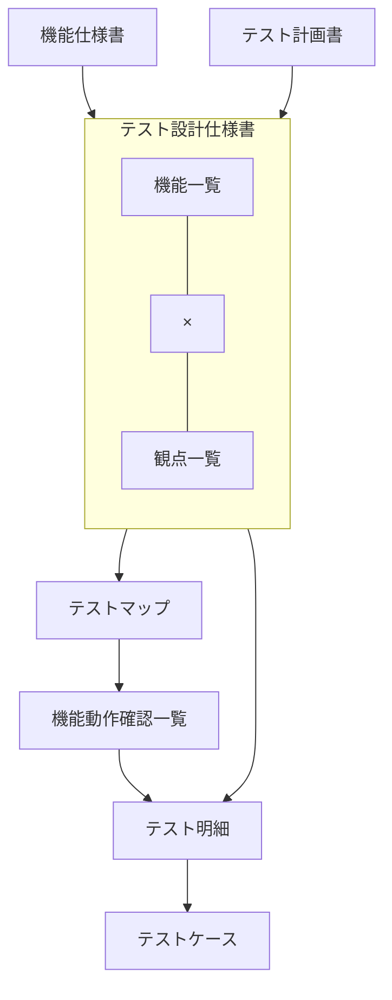

# Test Design Specification

<!-- 作成方法：[テスト文書作成ガイドライン](../../guidelines/documentation/test-documentation-guidelines.md#5-test-design-specification) -->

| 項目 | 内容 |
| --- | --- |
| 対象 | <テスト対象の名称> |
| 版 | 0.1.0 |
| ステータス | draft |
| 責任者 | <本書の内容を最終承認する人> |
| 作成者 | <氏名> |
| 発行組織 | <組織名> |

## 1 はじめに

### 1.1 目的

本書は、<対象システム>のテスト設計者及び実施者に向けて、確認する機能及び観点を示し、テストケースの作成方針を共有する。

### 1.2 適用範囲

本書は、<テスト対象、対象の版及びテストタイプ>の設計に適用する。

### 1.3 上位文書

次に掲げる上位文書は、本書に引用されることによって、その一部又は全部が本書の要求事項を構成している。

上位文書は、[表1](#table-1)による。

表1−上位文書

| 文書番号 | 名称 |
| --- | --- |
| <番号> | <実際のTest Planの題名及びリンク> |

### 1.4 用語及び定義

本書で用いる主な用語及び定義は、[表2](#table-2)による。

表2−用語及び定義

| 用語 | 定義 |
| --- | --- |
| <用語> | <その用語が指す概念>。 |

## 2 テスト設計の流れ

### 2.1 テスト設計の流れの要点

テスト設計では、次のステップを順に行うこととする。

処理の流れを[図1](#figure-1)に示す。

図1−処理の流れ

### 2.2 テスト対象項目を細分化する

テスト計画書に記載のテスト対象項目をテスト設計が容易な単位に細分化する。

作成資料：機能一覧　等

### 2.3 テスト観点を細分化する

テスト計画書に記載のテスト観点をテスト設計が容易な単位に細分化する。

作成資料：観点一覧　等

### 2.4 (1)、(2)で抽出した内容をマトリクス化する

テスト対象項目とテスト観点とでマトリクスを作成し、テスト実施可否及び重要度を決定する。

作成資料：テストマップ　等

### 2.5 (1)で抽出した機能に必要な検証内容を洗い出す

テスト対象項目に対して、各機能の目的を考慮し、その達成確認のために必要な確認内容を洗い出す。

作成資料：機能動作確認一覧　等

### 2.6 テスト明細を作成する

テスト実施対象機能ごとに、テスト観点に合わせた入力内容を抽出及び策定する。

作成資料：テスト明細　等

### 2.7 テストケースを作成する

テスト明細を基に、具体的なテスト手順書（テストケース）を作成する。

作成資料：テストケース

## 3 テストアプローチ詳細

### 3.1 テスト対象機能を細分化する

#### 3.1.1 テスト対象機能一覧

テスト対象機能一覧は、[表3](#table-3)による。

表3−テスト対象機能一覧

| 機能No | 大項目 | 中項目 | 小項目 | 重要度 | 備考 |
| --- | --- | --- | --- | --- | --- |
| <記載> | <記載> | <記載> | <記載> | <記載> | <記載> |

#### 3.1.2 特記事項

<記載>

### 3.2 テスト対象観点を細分化する

#### 3.2.1 テスト観点一覧

テスト観点一覧は、[表4](#table-4)による。

表4−テスト観点一覧

| No | 大分類 | 中分類 | 小分類 | 確認内容 |
| --- | --- | --- | --- | --- |
| <記載> | <記載> | <記載> | <記載> | <記載> |

#### 3.2.2 特記事項

<記載>

### 3.3 抽出した機能及び観点をマトリクス化する（テストマップ）

テスト対象となる機能及び観点の相関図及び確認重要度を記載する。

[Test Map](test-map.md)の形式で機能と観点との対応を記載する。

<テストマップの参照先>

### 3.4 観点“機能動作”に対して、機能ごとの確認内容を明確にする

[Functional Behavior Checklist](functional-behavior-checklist.md)の形式で確認内容を記載する。

観点“機能動作”に対する機能ごとの確認内容は、[表5](#table-5)による。

表5−観点“機能動作”に対して、機能ごとの確認内容を明確にする

| 記載事項 | − | 記載内容 |
| --- | --- | --- |
| テスト対象機能 | 大項目 | 該当テスト項目で確認する機能の大分類（機能一覧参照） |
| テスト対象機能 | 中項目 | 該当テスト項目で確認する機能の中分類（機能一覧参照） |
| テスト対象機能 | 小項目 | 該当テスト項目で確認する機能の小分類（機能一覧参照） |
| 機能要件（要求／リスクベース） | 機能要件（要求／リスクベース） | 機能に対して必要な要件 |
| 確認内容 | 確認内容 | 機能要件の確認に必要な内容 |

### 3.5 テスト明細を作成する

#### 3.5.1 テスト明細を作成するの要点

テスト対象となる機能と観点との組合せに対して、実施するテスト内容の明細を次の項目で記載する。

#### 3.5.2 グループ項目

グループ項目は、[表6](#table-6)による。

表6−グループ項目

| 記載項目 | 記載内容 |
| --- | --- |
| テスト対象1 | テストを実施する対象システム |
| テスト対象2 | テストを実施する対象システム内要素 |
| テストタイプ | 該当テストの分類 |
| 機能大項目 | 該当テスト項目で確認する機能の大分類（機能一覧参照） |

#### 3.5.3 個別項目

個別項目は、[表7](#table-7)による。

表7−個別項目

| 記載事項 | − | 記載内容 |
| --- | --- | --- |
| テストセットID | テストセットID | 該当テストセットの識別番号 |
| 要求事項の識別子 | 要求事項の識別子 | テストセットで確認する要求事項の識別子 |
| 機能中項目 | 機能中項目 | 該当テスト項目で確認する機能の中分類（機能一覧参照） |
| 機能小項目 | 機能小項目 | 該当テスト項目で確認する機能の小分類（機能一覧参照） |
| セット内容 | セット内容 | テストセットの内容説明 |
| テスト観点 | テスト観点 | テストマップにおけるテスト対象機能に対応したテスト観点 |
| テスト観点 | 確認内容 | テスト観点毎の詳細な確認内容。観点一覧から抽出し、詳細化する。 |
| テストパラメーター | テストパラメーター | 確認内容の入力条件パターン |
| 件数 | 件数 | 該当のテスト実施時に必要となるテスト件数 |

### 3.6 テストケースを作成する

#### 3.6.1 テストケースを作成するの要点

テスト明細を基に、具体的なテスト手順書（テストケース）を作成する。

テストケースでは、テストで実施する内容を次の項目で記載する。

#### 3.6.2 グループ項目

グループ項目は、[表8](#table-8)による。

表8−グループ項目

| 記載項目 | 記載内容 | 記載担当者 |
| --- | --- | --- |
| テスト対象1 | テストを実施する対象システム | テスト設計者 |
| テスト対象2 | テストを実施する対象システム内要素 | テスト設計者 |
| テストタイプ | 該当テストの分類 | テスト設計者 |
| 機能大項目 | 該当テスト項目で確認する機能の大分類（機能一覧参照） | テスト設計者 |
| 予定実施時間 | 実施するのにかかる時間（予定） | テスト設計者 |
| 注意事項 | テストを実施する際の注意事項 | テスト設計者 |

#### 3.6.3 個別項目

個別項目は、[表9](#table-9)による。

表9−個別項目

| 記載項目 | 記載内容 | 記載担当者 |
| --- | --- | --- |
| テストケースNo. | 該当テスト項目の識別番号。`テストセットID-ケースNo-期待結果枝番`の形式で記載する。 | テスト設計者 |
| 要求事項の識別子 | テストケースで確認する要求事項の識別子 | テスト設計者 |
| 機能中項目 | 該当テスト項目で確認する機能の中分類（機能一覧参照） | テスト設計者 |
| 機能小項目 | 該当テスト項目で確認する機能の小分類（機能一覧参照） | テスト設計者 |
| テスト観点 | そのテストケースで何を確認するのか | テスト設計者 |
| 実施条件 | テスト実施に必要な条件 | テスト設計者 |
| 実施手順 | テスト実施の詳細な手順 | テスト設計者 |
| 期待結果 | テスト実施時に期待される結果 | テスト設計者 |

#### 3.6.4 結果記載欄

結果記載欄は、[表10](#table-10)による。

表10−結果記載欄

| 記載項目 | 記載内容 | 記載担当者 |
| --- | --- | --- |
| 結果 | テスト実施結果のステータス。ステータスの詳細はTest Planを参照する。 | テスト実施者 |
| 環境 | テストを実施した環境 | テスト実施者 |
| 版 | テストを実施したテスト対象のバージョン | テスト実施者 |
| 実施日 | テストを実施した日付 | テスト実施者 |
| バグID | 不具合が発生した場合 不具合の識別番号 | テスト実施者 |
| 実施者 | テストを実施した人の氏名 | テスト実施者 |
| 備考 | テスト確認内容・確認結果の詳細など | テスト実施者 |

## 4 特記事項

本書の対象範囲又は設計方針が変更された場合は、本書及び関連するテスト文書の対応を確認する。

## 参考文献

| 本書の章 | 参考文献 | 概要 |
| --- | --- | --- |
| <章番号>章 | <資料の題名及びリンク> | <資料全体の内容を1文で記載>。 |

## 変更履歴

| 版 | 日付 | 変更内容 |
| --- | --- | --- |
| <版> | <YYYY-MM-DD> | <該当する章番号及び要点> |
