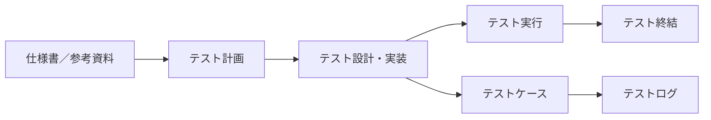

# Test Plan

<!-- 作成方法：[テスト文書作成ガイドライン](../../guidelines/documentation/test-documentation-guidelines.md#4-test-plan) -->

| 項目 | 内容 |
| --- | --- |
| テスト対象システム名 | <記載> |
| テストレベル／テストタイプ | <記載> |
| ステータス | <記載> |
| 文書番号 | <記載> |
| 版 | `0.0.0` |
| 発行組織 | <記載> |
| 責任者 | <記載> |

<!-- 文書番号はプロジェクトに応じて決定する。 -->

<!-- 組織名称、作成者氏名を明記する。 -->

## 1 はじめに

### 1.1 目的

この文書は、<テスト対象>の計画者、設計者及び実施者に向けて、テストの実施方針を共有し、実行及び完了を判断する基準を示す。

### 1.2 適用範囲

この文書は、<対象システム及び対象の版>の<テストレベル>に適用する。

### 1.3 用語及び定義

この文書で用いる主な用語及び定義は、[表1](#table-1)による。

表1−用語及び定義

| 用語 | 定義 |
| --- | --- |
| <用語> | <その用語が指す概念>。 |

## 2 テスト対象

### 2.1 この文書の対象

この文書の対象は、[表2](#table-2)による。

表2−この文書の対象

| 項目 | 内容 |
| --- | --- |
| 名称 | <記載> |
| 対象ユーザー | <記載> |
| システム目的 | <記載> |
| システム詳細 | <記載> |
| 開発分類及び内容 | <記載> |

<!-- 詳細を書くことでテストのスコープを明確化する。 -->

### 2.2 テストベース

この文書を作成するに当たり、参照した資料の一覧を記載する。

テストベースは、[表3](#table-3)による。

表3−テストベース

| No | 資料名称 | 作成者 | Ver | 受領日 | 備考 |
| --- | --- | --- | --- | --- | --- |
| 1 | − | − | − | − | − |
| 2 | − | − | − | − | − |
| 3 | − | − | − | − | − |
| 4 | − | − | − | − | − |
| 5 | − | − | − | − | − |
| 6 | − | − | − | − | − |
| 7 | − | − | − | − | − |
| 8 | − | − | − | − | − |
| 9 | − | − | − | − | − |
| 10 | − | − | − | − | − |

<!-- 参考資料、資料の場所などを記載する。 -->

## 3 テストの状況

### 3.1 テストの背景

テストの背景は、[表4](#table-4)による。

表4−テストの背景

| 項目 | 内容 |
| --- | --- |
| 現在の状況 | <記載> |
| 問題点/懸念事項 | <記載> |

<!-- 背景、実施において求められることを記載する。 -->

### 3.2 テストの目的及び目標

テストの目的及び目標は、[表5](#table-5)による。

表5−テストの目的及び目標

| 項目 | 内容 |
| --- | --- |
| テストの目的 | <記載> |
| テストの目標 | <記載> |

<!-- 目的は、端的に文章でまとめて記載する。 -->

<!-- テストアイテムの目的にならないこと。 -->

<!-- 目的が複数ある場合は目的1、目的2…と明記する。 -->

## 4 プロジェクト全体における位置付け

### 4.1 対象テストレベル

対象テストレベルは、[表6](#table-6)による。

表6−対象テストレベル

| 項目 | 内容 |
| --- | --- |
| テストレベル | <記載> |

### 4.2 プロジェクト全体の状況

プロジェクト全体の状況は、[表7](#table-7)による。

表7−プロジェクト全体の状況

| 開発工程/テストレベル | 進捗状況 | 特記事項 |
| --- | --- | --- |
| 要件定義 | <記載> | <記載> |
| 基本設計 | <記載> | <記載> |
| 詳細設計 | <記載> | <記載> |
| 実装 | <記載> | <記載> |
| 単体テスト | <記載> | <記載> |
| 結合テスト | <記載> | <記載> |
| システムテスト | <記載> | <記載> |

<!-- プロジェクトに応じて修正する。 -->

### 4.3 具体的な改修内容

このテスト対象の改修内容は次による。

- <記載>

- <記載>

- <記載>

- <記載>

- <記載>

- <記載>

<!-- 派生開発又はバージョンアップの場合、具体的な改修ポイントを記載する。 -->

<!-- プロジェクトに応じて修正する。 -->

### 4.4 テストアイテム

テストアイテムは、[表8](#table-8)による。

表8−テストアイテム

| No. | テストアイテム | 概要 |
| --- | --- | --- |
| 1 | − | − |
| 2 | − | − |

テストアイテムの補足

- <記載>

- <記載>

- <記載>

<!-- 量が多い場合は、別資料にしてもよい。 -->

### 4.5 テストタイプ

このテストの対象は、次のとおりである。

テストタイプは、[表9](#table-9)による。

表9−テストタイプ

| − | 1 | 2 | 3 | 4 | 5 | 6 | 7 | 8 | 9 | 10 |
| --- | --- | --- | --- | --- | --- | --- | --- | --- | --- | --- |
| 実施対象のテスト | 機能テスト | シナリオ | 性能テスト | ロードテスト | ストレステスト | ユーザビリティテスト | ローカライゼーションテスト | 保守性テスト | 信頼性テスト | 移植性テスト |
| このテストの対象＝〇 | − | − | − | − | − | − | − | − | − | − |

テストタイプは、[表10](#table-10)による。

表10−テストタイプ

| テストタイプ | 説明（参考） |
| --- | --- |
| 機能テスト | テスト対象のソフトウェア又はアプリケーションの“機能”が期待どおりの結果を返すか確認するテスト |
| シナリオテスト | 利用者の実際の利用手順に沿って操作を行い 問題なく利用できるか確認するテスト |
| 性能テスト | ソフトウェアの処理時間などのパフォーマンスを測定するテスト |
| ロードテスト | ソフトウェアを 様々な状況で動作させて 期待どおりの結果を返すか確認するテスト |
| ストレステスト | ソフトウェアが要件で定義される限界、又はそれ以上の負荷を与えて動作を確認するテスト |
| ユーザビリティテスト | ソフトウェアが、ユーザーにとって理解されやすく、使用が容易で、魅力的であるかどうかを確認するテスト |
| ローカライゼーションテスト | 異なる言語を使用してアプリケーションに変換されたときにソフトウェアが機能することを確認するためのテスト |
| 保守性テスト | ソフトウェアに欠陥があった場合の修正の容易さ、新しい機能の追加の容易さなどを確認するテスト |
| 信頼性テスト | ソフトウェアが要件で定めた回数、期間、条件などで稼働できるかを確認するテスト（大容量テスト、エージングテストなど） |
| 移植性テスト | 将来的に、ソフトウェアを別のハードウェア又は環境に移す場合の移植の容易さを確認するテスト |

## 5 テスト作業全体の流れ及び成果物

### 5.1 テスト作業全体の流れ及び成果物の要点

このテストでは、次の作業を行うこととする。

### 5.2 作業の流れ

処理の流れを[図1](#figure-1)に示す。

図1−処理の流れ

### 5.3 工程ごとの成果物

工程ごとの成果物は、[表11](#table-11)による。

表11−工程ごとの成果物

| テストフェーズ | 作業内容 | 中間生成物（※1） | 成果物（※2） |
| --- | --- | --- | --- |
| − | − | − | − |

※1 中間生成物はテスト内容に合わせて変動する。

※2 各成果物の詳細は、[9章](#9-スケジュール及び成果物)による。

## 6 テストスコープ

### 6.1 テスト対象システムイメージ

<プロジェクトの内容に合わせてイメージ図を作成する>

### 6.2 テスト対象範囲

#### 6.2.1 テスト対象範囲の要点

このテストの対象／非対象となる、機能及び範囲を次に記載する。

#### 6.2.2 テスト対象機能

テスト対象機能は、[表12](#table-12)による。

表12−テスト対象機能

| No | 機能（大分類） | 概要 |
| --- | --- | --- |
| <記載> | <記載> | <記載> |

#### 6.2.3 テスト非対象機能

テスト非対象機能は、[表13](#table-13)による。

表13−テスト非対象機能

| No | 機能（大分類） | 概要 |
| --- | --- | --- |
| <記載> | <記載> | <記載> |

## 7 プロダクトリスク

事前に評価及び分析されたプロダクトリスク、及びリスク低減策は次による。

分析の内容及びリスク低減策をを基に、テスト設計でテストの優先順位付けを行う。

<プロダクトリスクの図表を記載するか、別資料の参照先を記載する>

<!-- リスクを図表で作成する。別紙参照とする場合、その旨を記載して図表は削除する。 -->

## 8 テスト設計方針

### 8.1 各機能における観点（大分類／中分類）

観点（大分類／中分類）

各機能における観点（大分類／中分類）は、[表14](#table-14)による。

表14−各機能における観点（大分類／中分類）

| 機能（大分類／中分類） | 1 | 2 | 3 | 4 | 5 | 6 | 7 | 8 | 9 | 10 | 11 | 12 |
| --- | --- | --- | --- | --- | --- | --- | --- | --- | --- | --- | --- | --- |
| 1 | − | − | − | − | − | − | − | − | − | − | − | − |
| 2 | − | − | − | − | − | − | − | − | − | − | − | − |
| 3 | − | − | − | − | − | − | − | − | − | − | − | − |
| 4 | − | − | − | − | − | − | − | − | − | − | − | − |
| 5 | − | − | − | − | − | − | − | − | − | − | − | − |
| 6 | − | − | − | − | − | − | − | − | − | − | − | − |
| 7 | − | − | − | − | − | − | − | − | − | − | − | − |
| 8 | − | − | − | − | − | − | − | − | − | − | − | − |

<!-- テスト対象に応じて修正する。 -->

### 8.2 テストアイテム別重要度

各テストアイテムにおいて、テスト実施時の確認重要度（重点的に実施：A>B>C：最低限実施）は次のとおりとする。

テストアイテム別重要度は、[表15](#table-15)による。

表15−テストアイテム別重要度

| No | テストアイテム | 重要度 | 設定理由 |
| --- | --- | --- | --- |
| 1 | <記載> | <記載> | <記載> |
| 2 | <記載> | <記載> | <記載> |
| 3 | <記載> | <記載> | <記載> |
| 4 | <記載> | <記載> | <記載> |

<!-- テスト対象に応じて修正する。 -->

### 8.3 観点重要度

各テスト観点において、テスト実施時の確認重要度（重点的に実施：A>B>C：最低限実施）は次のとおりとする。

観点重要度は、[表16](#table-16)による。

表16−観点重要度

| No | 観点（大分類） | 重要度 | 設定理由 |
| --- | --- | --- | --- |
| 1 | <記載> | <記載> | <記載> |
| 2 | <記載> | <記載> | <記載> |
| 3 | <記載> | <記載> | <記載> |
| 4 | <記載> | <記載> | <記載> |

<!-- テスト対象に応じて修正する。プロダクトリスクのリスクスコアを重要度に反映する。 -->

### 8.4 機能重要度

各機能（大分類）において、テスト実施時の確認重要度（重点的に実施：A>B>C：最低限実施）は次のとおりとする。

機能重要度は、[表17](#table-17)による。

表17−機能重要度

| No | 機能（大分類） | 重要度 | 設定理由 |
| --- | --- | --- | --- |
| 1 | <記載> | <記載> | <記載> |
| 2 | <記載> | <記載> | <記載> |
| 3 | <記載> | <記載> | <記載> |
| 4 | <記載> | <記載> | <記載> |

<!-- テスト対象に応じて修正する。プロダクトリスクのリスクスコアを重要度に反映する。 -->

### 8.5 テストに用いる技法

各テストアプローチに対して、使用するテスト技法を選定する。

テストに用いる技法は、[表18](#table-18)による。

表18−テストに用いる技法

| No | テストタイプ | アプローチ内容 | 使用する技法 |
| --- | --- | --- | --- |
| 1 | − | − | − |
| 2 | − | − | − |
| 3 | − | − | − |
| 4 | − | − | − |
| − | − | − | − |

<!-- スコープに対してどのテスト設計技法を用いるかを指定する。 -->

## 9 スケジュール及び成果物

### 9.1 テスト期間

テスト期間は、[表19](#table-19)による。

表19−テスト期間

| 作業内容 | 予定期間 | 工数（単位） |
| --- | --- | --- |
| テスト全体 | ～ | − |
| 仕様理解 | ～ | − |
| テスト計画 | ～ | − |
| テスト設計 | ～ | − |
| テスト実装 | ～ | − |
| テスト実行 | ～ | − |
| テスト終結 | ～ | − |

### 9.2 スケジュール

このテストは、次のスケジュールに沿って行う。

※ その他の中間生成物は、別途決定する。

スケジュールは、[表20](#table-20)による。

表20−スケジュール

| 作業内容 | 予定期間 | マイルストーン |
| --- | --- | --- |
| 仕様理解 | <開始日>～<終了日> | <記載> |
| テスト計画 | <開始日>～<終了日> | <記載> |
| └ テスト計画書作成 | <開始日>～<終了日> | <記載> |
| テスト設計 | <開始日>～<終了日> | <記載> |
| ├ テスト設計仕様書作成 | <開始日>～<終了日> | <記載> |
| ├ テストマップ作成 | <開始日>～<終了日> | <記載> |
| └ テスト明細作成 | <開始日>～<終了日> | <記載> |
| <テストレベル1> | <開始日>～<終了日> | <記載> |
| ├ テストケース作成 | <開始日>～<終了日> | <記載> |
| ├ テスト環境構築 | <開始日>～<終了日> | <記載> |
| ├ テストデータ作成 | <開始日>～<終了日> | <記載> |
| ├ テスト実施 | <開始日>～<終了日> | <記載> |
| └ テスト報告提出 | <開始日>～<終了日> | <記載> |
| <テストレベル2> | <開始日>～<終了日> | <記載> |
| ├ テストケース作成 | <開始日>～<終了日> | <記載> |
| ├ テスト環境構築 | <開始日>～<終了日> | <記載> |
| ├ テストデータ作成 | <開始日>～<終了日> | <記載> |
| ├ テスト実施 | <開始日>～<終了日> | <記載> |
| └ テスト報告提出 | <開始日>～<終了日> | <記載> |

### 9.3 成果物

このテストの成果物を以下に記載する。

※ 中間生成物は、別途決定する。

成果物は、[表21](#table-21)による。

表21−成果物

| 成果物名 | 成果物概要 | 納期 |
| --- | --- | --- |
| <記載> | <記載> | <記載> |

<!-- テスト対象に応じて記載する。 -->

### 9.4 見積

この文書に基づく見積は別紙を参照する。

## 10 テスト実施時の各種判定基準

### 10.1 テスト開始／終了基準

このテストにおける運用について、次に記載する。

<テスト開始基準/終了基準>

テスト開始／終了基準は、[表22](#table-22)による。

表22−テスト開始／終了基準

| 基準 | 条件 |
| --- | --- |
| テスト開始基準 | <記載> |
| テスト終了基準 | <記載> |

### 10.2 テスト中断／再開基準

このテストにおける運用について、次に記載する。

テストの中断／再開については、<協議体又は責任者>において都度協議する。

※ リグレッションテストは、その時点でのリスクにもとづきテストマネージャーの裁量で実施する。

<中断基準/再開基準>

テスト中断／再開基準は、[表23](#table-23)による。

表23−テスト中断／再開基準

| 基準 | 条件 |
| --- | --- |
| テスト中断基準 | <記載> |
| テスト再開基準 | <記載> |

### 10.3 テスト完了基準

このテストにおける運用について、次に記載する。

<テスト完了基準>

テスト完了基準は、[表24](#table-24)による。

表24−テスト完了基準

| 基準 | 条件 |
| --- | --- |
| テスト完了基準 | − |

<!-- テスト完了基準の事例を列挙しているため、必要に応じてカスタマイズする。 -->

### 10.4 再テスト／リグレッションテスト実施条件

<再テスト／リグレッションテスト実施条件>

再テスト／リグレッションテスト実施条件は、[表25](#table-25)による。

表25−再テスト／リグレッションテスト実施条件

| 基準 | 条件 |
| --- | --- |
| 再テスト | <記載> |
| リグレッションテスト | <記載> |

### 10.5 テスト実施結果の判定基準

テスト実施結果の判定基準は、[表26](#table-26)による。

表26−テスト実施結果の判定基準

| ステータス | 説明 | 判定基準／判定例 |
| --- | --- | --- |
| OK | 問題なくテストが完了した項目 | <記載> |
| NG | インシデントが検出された項目 | <記載> |
| QA | QA表で質問中の項目 | <記載> |
| NT | テストを実施しない項目 ※同義語：テスト対象外 | <記載> |
| N/A | テスト実施ができない項目 ※同義語：不可、機能削除、Dropなど | <記載> |
| 保留 | 最終的には実施可能であるが 現状は 何らかの事情で実施ができない項目 | <記載> |

<!-- テスト実行時のログ記録について取り決めがある場合は記載する。 -->

### 10.6 インシデント判定基準

インシデントを検出した場合は、次の判定表に基づいてランクを決定する。

インシデント判定基準は、[表27](#table-27)による。

表27−インシデント判定基準

| ランク | 説明 |
| --- | --- |
| ランクA | 基本操作で機能が正常に動作しない 仕様、マニュアルと異なる動作 ユーザーが回避操作不能（フリーズ、リセットなど） |
| ランクB | ある条件において正常に動作しない 通常想定される性能を大きく下回る ユーザーが回避操作可能 |
| ランクC | 特殊条件において機能が正常に動作しない 通常想定される性能をやや下回る 仕様と区別がつかない |
| ランクD | 機能、性能、表示系などに対する要望、改良などの提案 |

<!-- 必要に応じてカスタマイズする。 -->

### 10.7 質問事項重要度の判定基準

質問事項が発生した場合は、次の判定表に基づいて重要度を決定する。

質問事項重要度の判定基準は、[表28](#table-28)による。

表28−質問事項重要度の判定基準

| 重要度 | 説明 |
| --- | --- |
| 高 | テスト実施進捗に影響のおよぶテストケースの数が<高重要度のしきい値>件以上ある質問 仕様書のバージョンが更新される際に、変更された機能 |
| 中 | テスト実施進捗に影響のおよぶテストケースの数が<中重要度の下限>～<中重要度の上限>件の質問 仕様書にて、操作手順が不明 |
| 低 | テスト実施進捗に影響のおよぶテストケースの数が<低重要度の上限>件までの質問 画面レイアウト又は文字の表示位置に関する質問 |

<!-- 必要に応じてカスタマイズする。 -->

### 10.8 テスト実行時の記録について

テスト実行ログには、テスト実施日、テスト実施者、テスト実行環境（バージョンなど）及び判定結果を記録する。

テスト判定結果が“NG”の場合、インシデントを発行し、管理IDを記録する。

※ 必要に応じて、不具合発生時の画面キャプチャを残す。

再テストが“OK”の場合、インシデントを更新する。

<!-- 必要に応じてカスタマイズする。 -->

## 11 収集するメトリクス

テスト完了時に作成するテストサマリレポートでは、テスト設計からテスト実施までに収集したデータを基に分析を行う。

次に、このプロジェクトの分析のためにサマリレポートに記載する項目及び必要なデータを示す。

収集するメトリクスは、[表29](#table-29)による。

表29−収集するメトリクス

| 記載対象項目 | 必要データ | 開発提供 | 記載対象 |
| --- | --- | --- | --- |
| インシデント曲線 | テスト実施日/不具合件数/未解決件数 | － | 〇 |
| インシデント機能別（パレート図） | 機能別の不具合件数/累積割合 | － | 〇 |
| インシデント発生率 | テスト項目ごとの実施件数/不具合件数 | － | 〇 |
| 不具合検出率 | 検出済不具合総数/テストケース総数 | － | 〇 |
| 不具合収束状況 | 期間内の検出済不具合数/期間内のテスト実施時間 | － | 〇 |
| − | − | − | − |

凡例

〇：記載対象

×：記載非対象

<!-- 関係者と相談のうえで、記載対象を決定する。 -->

## 12 テスト環境要件及びテストデータ要件

### 12.1 テスト環境要件

テスト環境要件は次による。

テスト開始前までに、テスト開始条件を満たすことを確認する。

テスト環境要件は、[表30](#table-30)による。

表30−テスト環境要件

| No. | 検証環境 | 機材 | 検証環境要件詳細 | 提供 | 期間 |
| --- | --- | --- | --- | --- | --- |
| 1 | <記載> | <記載> | <記載> | <記載> | <記載> |
| 2 | <記載> | <記載> | <記載> | <記載> | <記載> |
| 3 | <記載> | <記載> | <記載> | <記載> | <記載> |
| 4 | <記載> | <記載> | <記載> | <記載> | <記載> |
| 5 | <記載> | <記載> | <記載> | <記載> | <記載> |

また、テストアイテムの比較対象として次の機材を使用する。

※ ベンチマーク時の他社比較機として使用

テスト環境要件は、[表31](#table-31)による。

表31−テスト環境要件

| No. | 型番 | FW Ver | スペック | 備考 |
| --- | --- | --- | --- | --- |
| 1 | <記載> | <記載> | <記載> | <記載> |
| 2 | <記載> | <記載> | <記載> | <記載> |
| 3 | <記載> | <記載> | <記載> | <記載> |

<!-- PC、スマートフォン、サーバー環境、提供元といった情報を記述する。 -->

<!-- 比較対象機材が不必要な場合は、削除する。 -->

### 12.2 テストデータ要件

このテストは、次の要件がそろったことを確認した後に、テストを開始する。

テストデータ要件は、[表32](#table-32)による。

表32−テストデータ要件

| ID | 説明 | 責任部門 | 期間 | リセット | アーカイブ |
| --- | --- | --- | --- | --- | --- |
| ID1 | <記載> | <記載> | <記載> | <記載> | <記載> |
| ID2 | <記載> | <記載> | <記載> | <記載> | <記載> |
| ID3 | <記載> | <記載> | <記載> | <記載> | <記載> |

※ リセットとは、要求に応じて責任部門がオリジナルのデータベースを復元する必要があることを意味する。

※ テストデータの詳細は、テスト設計仕様書にて記載する。

## 13 コミュニケーション・テスト体制

### 13.1 コミュニケーション／定期報告方針

このテストでは、次の要領に基づいて報告を行うものとする。

コミュニケーション／定期報告方針は、[表33](#table-33)による。

表33−コミュニケーション／定期報告方針

| 報告内容 | 手段 | タイミング |
| --- | --- | --- |
| テスト設計・仕様に関する質問 | <課題管理ツール／チャット／メール等> | 随時 |
| 進捗報告 | <会議／チャット／メール等> | <頻度・時刻> |
| インシデント報告 | <課題管理ツール等> | 随時 |
| 緊急連絡 | <電話／チャット／メール等> | 随時 |

<!-- プロジェクトの連絡手段、報告頻度、エスカレーション経路に合わせて定義する。 -->

<!-- 関係者と相談のうえで決定する。 -->

### 13.2 インシデントの報告及び運用の流れ

インシデントを検出した際の対応の流れを、次に記載する。

<インシデント掲出時の報告の流れを図で記載する>

<!-- 関係者と相談のうえで決定する。 -->

### 13.3 テスト体制

このテストにおけるテスト体制を以下に記載する。

<テストの実施体制を図で記載する>

### 13.4 テスト作業場所

このテストは、次の作業場所にて行う。

<テストの作業場所を記載する>

### 13.5 ステークホルダー

ステークホルダーは、[表34](#table-34)による。

表34−ステークホルダー

| 役割 | 役割 | 氏名 | 連絡先 |
| --- | --- | --- | --- |
| 開発PM | <記載> | <記載> | <記載> |
| 開発リーダー | <記載> | <記載> | <記載> |
| 開発担当 | <記載> | <記載> | <記載> |
| テストチームリーダー | <記載> | <記載> | <記載> |
| テスト設計担当 | <記載> | <記載> | <記載> |
| テスト実施担当 | <記載> | <記載> | <記載> |
| テスター | <記載> | <記載> | <記載> |

### 13.6 採用ニーズ

<テスト実施に必要な役割、スキル、人数、追加要員の要否を記載する。追加要員が不要な場合はその旨を記載する。>

### 13.7 トレーニングの必要性

<対象システム、テスト技法、テスト管理ツールなどについて事前教育が必要な場合、その対象者、内容、実施時期を記載する。>

### 13.8 テスト実施者の独立性

<開発担当者とテスト設計者・実施者の関係、レビュー体制、独立性を確保する必要がある場合の方針を記載する。>

## 14 予見できるリスク及びその対応方針

### 14.1 予見できるリスク及びその対応方針

テスト業務を行う上で、予見できるリスクとその対応について次に記載する。

予見できるリスクとその対応方針は、[表35](#table-35)による。

表35−予見できるリスクとその対応方針

| No. | 予見できるリスク | 対応方針 |
| --- | --- | --- |
| <記載> | <記載> | <記載> |

<!-- 事前に予見できるリスク、対応方針を明記する。 -->

### 14.2 プロジェクトリスク

現時点のプロジェクトリスク登録表は次による。

<プロジェクトリスク登録表を記載する>

<!-- スケジュール遅延、予算への過剰な負担など、プロジェクトの成果に影響を及ぼす要因を記載する。 -->

## 15 前提条件及び制限事項

### 15.1 計画の見直し

1. 仕様、開発スケジュール又はテスト対象範囲に大幅な変更が発生した場合はこの計画書の見直しを行う。
2. <テスト環境の利用に支障が見込まれる場合の通知条件と期限を記載する。>

### 15.2 制約事項

1. <ある場合、記載する>
2. <記載>

<!-- この文書に記載された内容についての、前提条件又は制約事項があれば記載する。なければ削除可能。 -->

## 16 特記事項

## 参考文献

| 本書の章 | 参考文献 | 概要 |
| --- | --- | --- |
| <章番号>章 | <資料の題名及びリンク> | <資料全体の内容を1文で記載>。 |

## 変更履歴

| 版 | 日付 | 変更内容 |
| --- | --- | --- |
| <版> | <YYYY-MM-DD> | <該当する章番号及び要点> |
